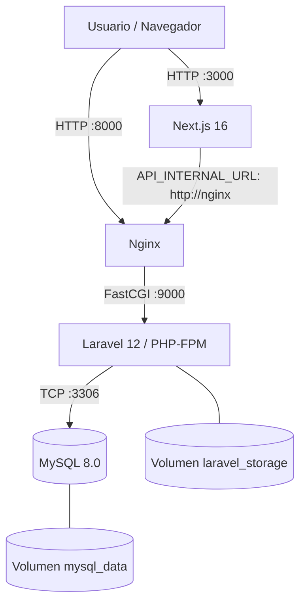

# E-Commerce Docker Multi-stage

**Ecosistema de comercio electrónico contenerizado con Next.js 16, Laravel 12, Nginx y MySQL 8**, desarrollado como actividad evaluada de ingeniería de imágenes eficientes en KODIGO.

Este proyecto integra dos aplicaciones existentes —un frontend en Next.js y una API REST en Laravel— mediante Docker Compose. Utiliza **Dockerfiles multi-stage**, caché de capas, dependencias de producción, usuarios no privilegiados y volúmenes persistentes para lograr un entorno reproducible de pruebas con configuración orientada a producción.

> **Alcance:** el ecosistema fue construido y probado localmente con Docker Desktop. La configuración utiliza HTTP y publica los servicios web solo en `127.0.0.1`; no constituye por sí sola un despliegue público endurecido para producción.

## Tecnologías

| Componente | Tecnología | Función |
|---|---|---|
| Frontend | Next.js 16.3.6, React 19, TypeScript, Tailwind CSS | Catálogo y experiencia de compra |
| Backend | Laravel 12, PHP 8.4-FPM | API REST, autenticación JWT, órdenes y pagos |
| Servidor web | Nginx Alpine | Proxy HTTP hacia PHP-FPM mediante FastCGI |
| Base de datos | MySQL 8.0 | Persistencia de usuarios, productos, órdenes y pagos |
| Orquestación | Docker Compose | Red, servicios, variables, dependencias y volúmenes |
| Documentación API | Swagger / OpenAPI (L5-Swagger) | Consulta y pruebas de endpoints |

**Nota sobre PHP:** aunque el proyecto Laravel declara compatibilidad con PHP `^8.3`, durante la construcción sus dependencias bloqueadas exigieron una versión superior. Por eso se utiliza `php:8.4-fpm-alpine`.

## Arquitectura



La arquitectura contiene **cuatro contenedores para tres componentes principales**: frontend, backend y base de datos. El backend se divide en Nginx y PHP-FPM porque PHP-FPM no sirve HTTP directamente.

- **Desde el navegador:** Next.js responde en `http://localhost:3000` y Nginx publica la API en `http://localhost:8000`.
- **Dentro de Docker:** los componentes de servidor de Next.js usan `API_INTERNAL_URL=http://nginx`. Nginx se comunica con `backend:9000` y Laravel con `mysql:3306`.
- **Seguridad de red local:** MySQL y PHP-FPM no publican puertos al host; los dos puertos HTTP están enlazados a `127.0.0.1`.
- **Persistencia:** los volúmenes `mysql_data` y `laravel_storage` sobreviven a la recreación normal de contenedores.

## Estructura del repositorio

```text
ecommerce-docker-multistage/
├── frontend/               # Código Next.js + Dockerfile multi-stage
├── backend/                # Código Laravel + Dockerfile multi-stage
├── database/               # Dockerfile basado en mysql:8.0
├── nginx/                  # Dockerfile y default.conf
├── docker-compose.yml      # Orquestación de los cuatro servicios
├── .env.example            # Variables de configuración de ejemplo
├── .gitignore              # Exclusiones de credenciales y dependencias
└── README.md               # Documentación del proyecto
```

## Requisitos

- Docker Desktop con Docker Engine y Docker Compose funcionando (o equivalente en Linux).
- Git para clonar el repositorio.
- Acceso a Internet para descargar imágenes y dependencias durante la primera construcción.

**No es necesario instalar localmente PHP, Composer, Node.js ni MySQL** para ejecutar los servicios mediante Docker.

## Instalación y ejecución

### 1. Clonar el repositorio

```bash
git clone https://github.com/hugo200021/ecommerce-docker-multistage.git
cd ecommerce-docker-multistage
```

Los directorios `frontend/` y `backend/` ya contienen el código fuente. No es necesario descargar otros repositorios ni mover archivos.

### 2. Preparar las variables de entorno

En **PowerShell (Windows)**:

```powershell
Copy-Item .env.example .env
notepad .env
```

En **Linux/macOS**:

```bash
cp .env.example .env
```

Configurar al menos:

| Variable | Uso |
|---|---|
| `MYSQL_ROOT_PASSWORD` | Contraseña del usuario root de MySQL |
| `DB_DATABASE` | Base de datos; por defecto `ecommerce_api` |
| `DB_USERNAME` | Usuario de la aplicación; por defecto `ecommerce` |
| `DB_PASSWORD` | Contraseña del usuario de la aplicación |
| `APP_KEY` | Clave de cifrado de Laravel; se genera en el siguiente paso |
| `JWT_SECRET` | Clave de firma JWT; se genera en el siguiente paso |
| `NEXT_PUBLIC_API_URL` | URL pública de la API, `http://localhost:8000` |
| `NEXT_PUBLIC_STRIPE_PUBLISHABLE_KEY` | Clave pública de Stripe de pruebas, si se usa |
| `STRIPE_KEY` / `STRIPE_SECRET` | Credenciales de Stripe de pruebas, si se usan |
| `ADMIN_NAME`, `ADMIN_EMAIL`, `ADMIN_PASSWORD` | Datos opcionales para el seeder de administrador |

**Nunca subas el archivo `.env` real ni claves de Stripe/JWT al repositorio.** El archivo `.env.example` contiene únicamente valores de ejemplo.

### 3. Construir las imágenes

```bash
docker compose config --quiet
docker compose build
```

La primera orden verifica la configuración de Compose; la segunda construye las cuatro imágenes. Los Dockerfiles de Next.js y Laravel separan las etapas de construcción y ejecución.

### 4. Generar claves de Laravel

```bash
docker compose run --rm --no-deps backend php artisan key:generate --show
docker compose run --rm --no-deps backend php artisan jwt:secret --show
```

Copia cada valor generado a `APP_KEY` y `JWT_SECRET`, respectivamente, en el `.env` de la raíz. No publiques ni compartas esos valores. Estos comandos muestran las claves, pero no editan automáticamente el `.env` del host.

### 5. Iniciar los servicios

```bash
docker compose up -d
docker compose ps
```

El comando `up` inicia los contenedores en segundo plano. Compose espera a que MySQL pase su comprobación de salud antes de iniciar el backend.

### 6. Inicializar Laravel y la base de datos

En la **primera ejecución**, prepara el descubrimiento de paquetes, las tablas y los datos de ejemplo:

```bash
docker compose exec backend php artisan package:discover --ansi
docker compose exec backend php artisan migrate --seed --force
docker compose exec backend php artisan l5-swagger:generate
```

Las migraciones crean las tablas de usuarios, productos, órdenes, detalles y pagos. Los seeders cargan productos de ejemplo. `AdminUserSeeder` solo crea el administrador cuando se configuran las credenciales necesarias.

No repitas los seeders indiscriminadamente sobre datos que desees conservar.

### 7. Acceder a las aplicaciones

| Recurso | URL |
|---|---|
| Tienda Next.js | http://localhost:3000 |
| Catálogo API (JSON) | http://localhost:8000/api/products |
| Producto individual | http://localhost:8000/api/products/1 |
| Swagger UI | http://localhost:8000/api/documentation |

## Decisiones técnicas de los Dockerfiles

### Frontend: cuatro etapas multi-stage

1. **`deps` — `node:22-alpine`:** copia `package.json` y `package-lock.json` antes de ejecutar `npm ci`, para aprovechar la caché mientras no cambien las dependencias.
2. **`builder`:** copia el código y ejecuta `npm run build` (`next build`). Recibe las variables públicas de compilación.
3. **`production_deps`:** instala solamente dependencias de producción mediante `npm ci --omit=dev` y limpia la caché de npm.
4. **`runner`:** contiene únicamente los artefactos `.next`, `public`, configuración, manifiesto y módulos de producción. Se ejecuta como usuario `node`, no root, con `npm run start` (`next start`) en el puerto 3000.

La etapa final utiliza `COPY --chown=node:node` para asignar directamente el propietario de los archivos en lugar de ejecutar posteriormente `RUN chown -R node:node /app`.

### Backend: cuatro etapas multi-stage

1. **`php_base` — `php:8.4-fpm-alpine`:** prepara PHP-FPM y extensiones como `pdo_mysql`, `mbstring`, `xml` y `opcache`.
2. **`dependencies`:** incorpora Composer y herramientas de instalación, copia los manifiestos e instala paquetes con `composer install --no-dev`.
3. **`builder`:** incorpora el código y genera el autoload optimizado.
4. **`runtime`:** parte de la imagen PHP base, copia el código de la API y el directorio `vendor/` generado; no hereda Git, Composer ni las herramientas de la etapa de dependencias. Se ejecuta como `www-data` mediante PHP-FPM en el puerto interno 9000.

### Nginx y MySQL

- **Nginx:** imagen Alpine con `default.conf`, que entrega solicitudes PHP mediante FastCGI a `backend:9000` y sirve recursos públicos de Laravel.
- **MySQL:** imagen oficial `mysql:8.0`, variables de inicialización, volumen `mysql_data` y `healthcheck`; puerto 3306 disponible solo dentro de la red Docker.

## Optimización de capas: resultados medidos

Durante las pruebas se identificó que `RUN chown -R node:node /app` añadía una capa costosa en el frontend. Se reemplazó por `COPY --chown=node:node` en la etapa `runner`, manteniendo el usuario sin privilegios.

| Métrica de la imagen frontend | Antes | Después | Diferencia |
|---|---:|---:|---:|
| `Disk Usage` reportado por Docker | 1.48 GB | 859 MB | ≈ 621 MB menos (≈ 42 %) |
| `Content Size` reportado por Docker | 334 MB | 197 MB | 137 MB menos |

Tamaños observados para las imágenes finales:

| Imagen | Disk Usage | Content Size |
|---|---:|---:|
| `ecommerce-docker-multistage-frontend` | 859 MB | 197 MB |
| `ecommerce-docker-multistage-backend` | 209 MB | 48.1 MB |
| `ecommerce-docker-multistage-nginx` | 92.7 MB | 26.1 MB |
| `ecommerce-docker-multistage-mysql` | 1.09 GB | 234 MB |

Mediciones realizadas con Docker Desktop/Engine en el equipo de prueba; no son tamaños de descarga de Docker Hub ni una comparación contra una implementación monolítica sin multi-stage. El tamaño puede variar según arquitectura, versiones y almacenamiento del motor.

La inspección con `docker history` mostró que las capas más voluminosas del frontend optimizado son `node_modules` (426 MB) y `.next` (58.1 MB). El proceso conserva `next start` para ajustarse al enunciado de la actividad.

## Pruebas realizadas

| Prueba | Resultado observado |
|---|---|
| `docker compose build` | Cuatro imágenes construidas correctamente |
| `docker compose ps` | Frontend, backend, Nginx y MySQL ejecutándose |
| Salud de MySQL | Estado `healthy` |
| `php artisan migrate --seed --force` | Migraciones y seeders ejecutados correctamente |
| `GET /api/products` | JSON exitoso con seis productos |
| `GET /api/products/1` desde Swagger | HTTP 200, producto encontrado |
| Navegación a `localhost:3000` | Catálogo de seis productos visible |
| `php artisan l5-swagger:generate` | Documentación generada |
| `docker compose down` y `up -d` | Los seis productos permanecieron en MySQL |
| Reconstrucción optimizada del frontend | Contenedor iniciado y catálogo funcional |

**Alcance de las pruebas:** se validó la infraestructura, la integración del catálogo y la persistencia. No se declara una cobertura exhaustiva de flujos de registro/login, autorización administrativa, creación de órdenes o cobros reales con Stripe. Las solicitudes con filtros o permisos inválidos pueden devolver HTTP 422 o 403 según las reglas de la API.

## Comandos de diagnóstico y mantenimiento

```bash
# Estado de contenedores
docker compose ps

# Registros de servicios
docker compose logs --tail 100 backend
docker compose logs --tail 100 frontend
docker compose logs --tail 100 nginx

# Imágenes del proyecto
docker image ls --filter "reference=ecommerce-docker-multistage-*"

# Inspección de capas
docker history ecommerce-docker-multistage-frontend:latest

# Reconstruir y actualizar solo el frontend
docker compose build frontend
docker compose up -d --no-deps frontend

# Apagar sin borrar los volúmenes
docker compose down
```

**Precaución:** `docker compose down -v` también elimina los volúmenes declarados y puede borrar los datos de MySQL.

## Seguridad y consideraciones para un despliegue real

- Variables sensibles excluidas mediante `.gitignore`; solo se publica `.env.example`.
- Frontend y backend utilizan usuarios no root en sus imágenes finales.
- Composer y herramientas de compilación de desarrollo no permanecen en la imagen final de Laravel; las dependencias de desarrollo de Node tampoco se instalan en el `runner`.
- MySQL no publica su puerto al equipo anfitrión y los puertos HTTP se limitan al loopback local.
- Laravel usa `APP_DEBUG=false` en Compose.
- `COOKIE_SECURE=false` es una excepción para pruebas locales HTTP. Un despliegue público requiere HTTPS y cookies seguras, además de gestión de secretos, controles de acceso, copias de seguridad y configuración de dominio/CORS.
- Las credenciales de Stripe son opcionales para probar el catálogo; los pagos solo deben probarse con credenciales de test válidas.
- Si una clave privada o un JWT se expone, debe invalidarse o rotarse antes de utilizar el entorno.

## Origen de los proyectos

La solución integra y adapta dos proyectos realizados previamente:

- [Frontend E-commerce — Next.js](https://github.com/hugo200021/frontend-ecommerce-nextjs)
- [E-commerce Secure API — Laravel](https://github.com/hugo200021/ecommerce-api-segura)

La actividad se concentra en **ingeniería de imágenes, optimización de capas, orquestación y reproducibilidad**, no en construir desde cero otra aplicación de comercio electrónico.

---

**Actividad evaluada — KODIGO | Ingeniería de Imágenes Eficientes: Refactorización Multi-stage y Optimización de Capas en Docker.**
